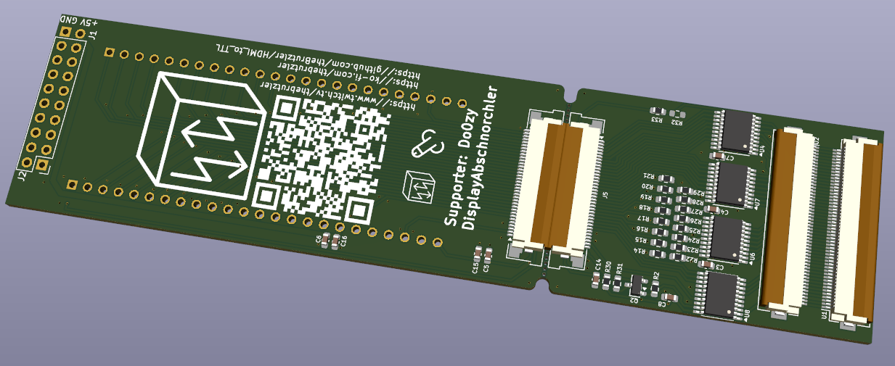
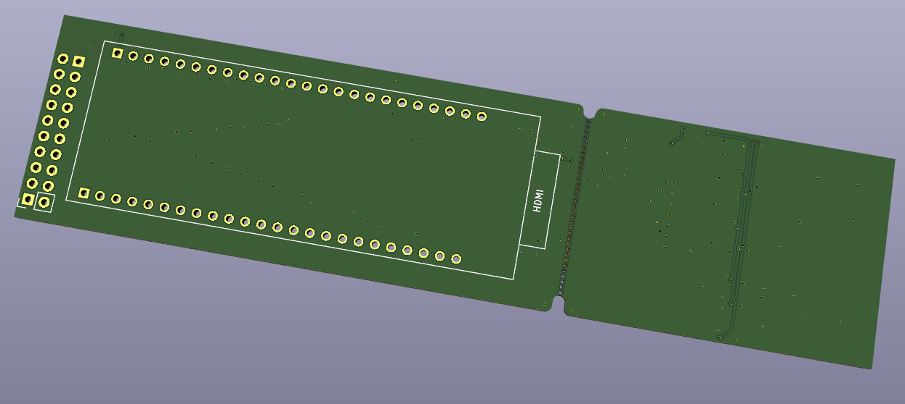
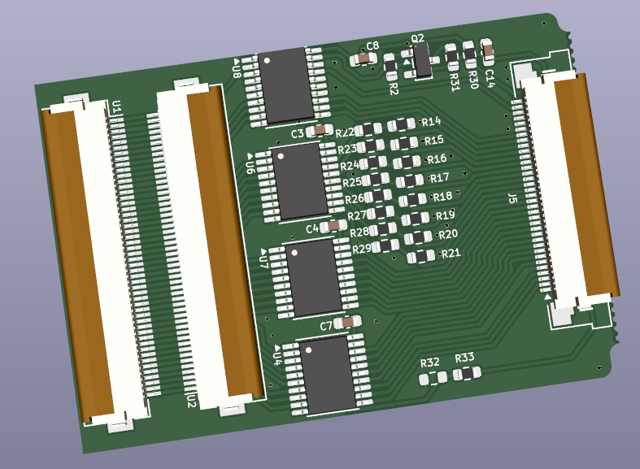
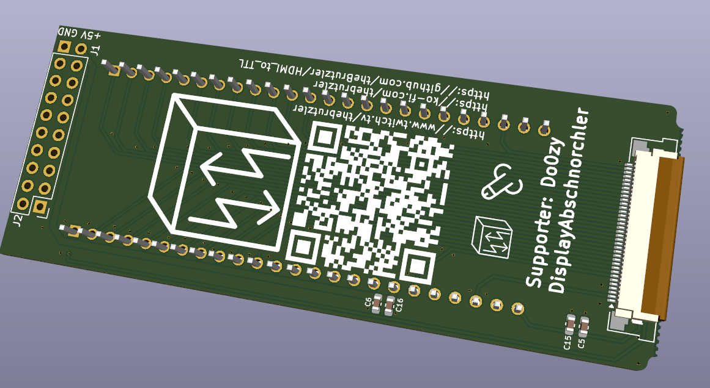
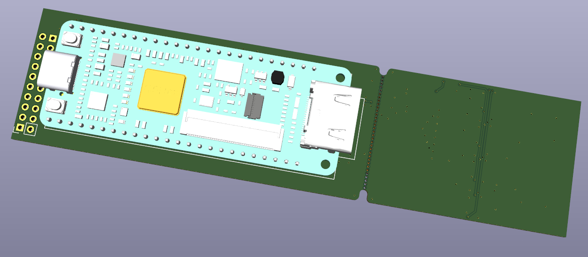
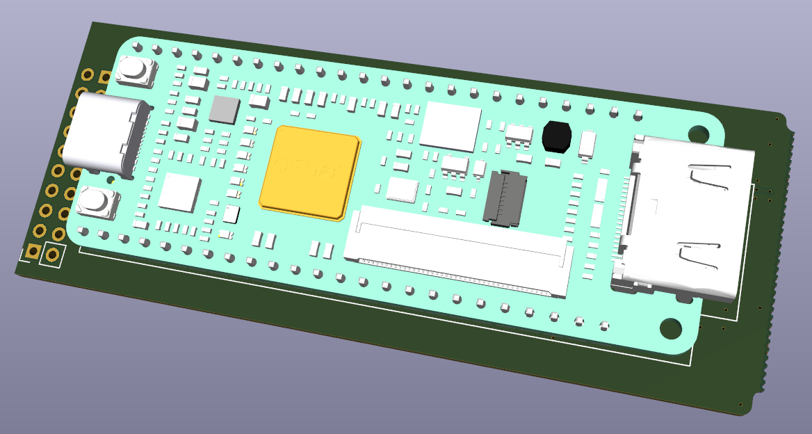
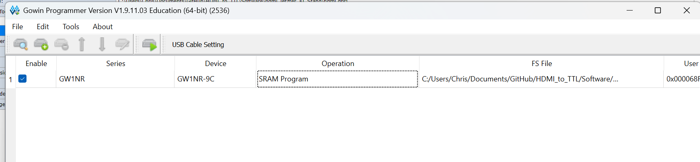
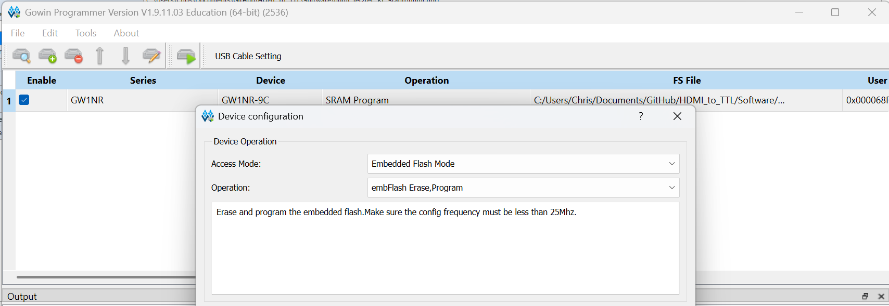
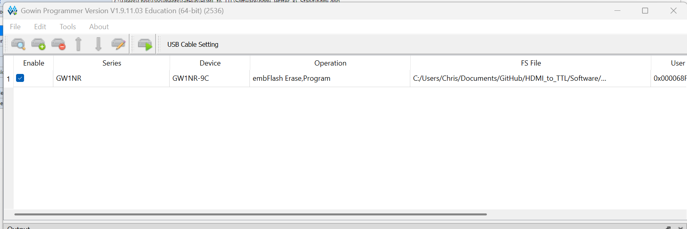

# HDMI_to_TTL

HDMI-Ausgang für das Rigol DS1054Z: Das parallele 24-Bit-RGB-Signal (800 × 480), das vom Mainboard zum internen Display geht, wird abgegriffen und von einem **Tang Nano 9K** (Gowin GW1NR-9C) in ein HDMI-Signal umgewandelt.

Diese Anleitung beschreibt, wie die Platine bestückt und der FPGA programmiert wird.

> ⚠️ **Haftungsausschluss:** Nachbau, Programmierung und Einbau erfolgen **auf eigene Gefahr**. Für das Öffnen des Oszilloskops wird ein Eingriff in das Gerät nötig, der zum Verlust der Garantie führen kann. Für Schäden am Oszilloskop, am Tang Nano 9K, an angeschlossenen Geräten oder sonstige Folgeschäden wird **keine Haftung übernommen**.

---

## Inhalt

1. [Benötigte Teile](#1-benötigte-teile)
2. [Die Platine](#2-die-platine)
3. [Platine trennen](#3-platine-trennen)
4. [Tang Nano 9K bestücken](#4-tang-nano-9k-bestücken)
5. [FPGA programmieren](#5-fpga-programmieren)
6. [Anschluss und Inbetriebnahme](#6-anschluss-und-inbetriebnahme)
7. [Fehlersuche (LEDs und UART)](#7-fehlersuche-leds-und-uart)

---

## 1. Benötigte Teile

| Teil | Bemerkung |
|---|---|
| Platine `TTL_to_HDMI` | Display-Teil und FPGA-Teil hängen als ein Nutzen zusammen |
| Tang Nano 9K | Sipeed, FPGA GW1NR-LV9QN88PC6/I5 |
| 2 × Stiftleiste 1 × 24, Raster 2,54 mm | für den Tang Nano 9K (liegen dem Board meist bei) |
| FFC-Kabel 35-polig, Raster 0,5 mm | verbindet Display-Teil (J5) und FPGA-Teil (J3) |
| USB-C-Kabel | **nur** zum Programmieren, solange das Board noch nicht eingebaut ist |
| PC mit **Gowin EDA / Gowin Programmer** | getestet mit Version V1.9.11.03 Education |

Die Display-Platine ist bereits mit SMD-Bauteilen bestückt (74HC245-Puffer U4, U6, U7, U8, Widerstände, Kondensatoren, FFC-Stecker).

---

## 2. Die Platine

Die Platine wird als ein Stück geliefert. Links sitzt der FPGA-Teil, rechts der Display-Teil, dazwischen eine Sollbruchstelle.

**Oberseite** – mit QR-Code, FFC-Steckern und den SMD-Bauteilen:



**Unterseite** – hier ist die Umrisslinie des Tang Nano 9K inklusive Lage der HDMI-Buchse aufgedruckt:



---

## 3. Platine trennen

Die beiden Teile an der Sollbruchstelle vorsichtig auseinanderbrechen und die Bruchkante bei Bedarf leicht entgraten.

**Display-Teil** – kommt ins Oszilloskop zwischen Mainboard und Display. U1/U2 sind die 50-poligen Display-Stecker, J5 ist der 35-polige Anschluss zum FPGA-Teil:



**FPGA-Teil** – Oberseite mit J3 (35-polig, zum Display-Teil) und J1 (+5 V / GND):



---

## 4. Tang Nano 9K bestücken

Der Tang Nano 9K wird auf der **Unterseite** des FPGA-Teils montiert, also auf der Seite mit der aufgedruckten Umrisslinie (nicht auf der QR-Code-Seite).

1. Die beiden Stiftleisten (1 × 24) in den Tang Nano 9K stecken.
2. Den Tang Nano 9K so auf die Unterseite der Platine setzen, dass er **in der Umrisslinie** liegt:
   - die **HDMI-Buchse** zeigt zur Bruchkante (Aufdruck „HDMI“),
   - die **USB-C-Buchse** zeigt zur Seite mit J1 / J2.
3. Die Stifte stehen dann auf der Oberseite (QR-Code-Seite) durch und werden dort verlötet.
4. Zuerst nur je einen Pin an beiden Enden löten, Lage prüfen (Board liegt plan und gerade in der Umrisslinie), dann die restlichen Pins löten.
5. Überstehende Stifte auf der Oberseite kürzen, damit sie später nichts berühren.

So sieht das bestückte FPGA-Teil aus (Unterseite, noch vor dem Trennen):



Und nach dem Trennen:



> **Hinweis:** J2 ist nur ein Dummy-Footprint und muss nicht bestückt werden.

---

## 5. FPGA programmieren

> ⚠️ **Wichtig:** Der Tang Nano 9K muss **vor dem Einbau** ins Oszilloskop fertig programmiert werden. Programmiert wird ausschließlich außerhalb des Geräts – das FPGA-Teil darf dabei **nicht** mit dem Oszilloskop verbunden sein.

Die fertige Konfigurationsdatei liegt im Repository unter:

```
Software/hdmi_letzter_Ki_Stand/impl/pnr/hdmi.fs
```

Wer das Projekt selbst neu bauen will, öffnet `Software/hdmi_letzter_Ki_Stand/hdmi.gprj` in der Gowin EDA und führt *Synthesize* und *Place & Route* aus – danach liegt die `hdmi.fs` an derselben Stelle.

### 5.1 Programmer starten und Board erkennen

1. Tang Nano 9K per USB-C mit dem PC verbinden.
2. **Gowin Programmer** starten (entweder einzeln oder in der Gowin EDA über *Tools → Programmer*).
3. Mit dem Lupen-Symbol (**Scan Device**) nach dem Board suchen. Es sollte ein Eintrag mit
   - Series: `GW1NR`
   - Device: `GW1NR-9C`

   erscheinen. Standardmäßig steht als Operation `SRAM Program` drin.



> `SRAM Program` lädt die Konfiguration nur in den flüchtigen Speicher – nach dem Ausschalten ist sie wieder weg. Damit der FPGA die Konfiguration dauerhaft behält, muss in den internen Flash geschrieben werden (nächster Schritt).

### 5.2 Flash-Programmierung einstellen

1. Doppelklick auf die Zeile (Spalte **Operation**) – das Fenster **Device configuration** öffnet sich.
2. Einstellen:
   - **Access Mode:** `Embedded Flash Mode`
   - **Operation:** `embFlash Erase,Program`
3. Unter **File name** die Datei `hdmi.fs` auswählen (Pfad siehe oben).
4. Mit **Save** bestätigen.



### 5.3 Programmieren

In der Liste steht jetzt als Operation `embFlash Erase,Program` und als FS File der Pfad zur `hdmi.fs`:



1. Auf das Symbol mit dem grünen Pfeil (**Program/Configure**) klicken.
2. Warten, bis im Output-Fenster unten die erfolgreiche Programmierung gemeldet wird.
3. Fertig – der FPGA startet ab jetzt bei jedem Einschalten mit der HDMI-Konfiguration.
4. USB-C-Kabel wieder abziehen. Erst jetzt darf das Board eingebaut werden.

> **Board wird nicht gefunden?** Unter **USB Cable Setting** prüfen, ob das Kabel erkannt wird, und ggf. *Query/Detect Cable* ausführen. Unter Windows wird ein passender USB-Treiber benötigt (wird mit der Gowin-Software installiert).

---

## 6. Anschluss und Inbetriebnahme

> 📷 Bilder vom Einbau folgen, sobald die finale Platine da ist.

> ⚠️ Der Einbau erfolgt **auf eigene Gefahr**, es wird **keine Haftung** übernommen. Vor dem Öffnen das Oszilloskop ausschalten und vom Netz trennen.

Voraussetzung: Der Tang Nano 9K ist fertig programmiert (siehe [Abschnitt 5](#5-fpga-programmieren)) und das USB-C-Kabel ist abgezogen.

1. Display-Teil im Oszilloskop zwischen Mainboard und Display einsetzen (Display-Flachbandkabel an U1/U2).
2. Display-Teil (J5) und FPGA-Teil (J3) mit dem 35-poligen FFC-Kabel verbinden.
3. J1 (**+5 V / GND**) mit der 5-V-Versorgung des Oszilloskops verbinden. Darüber wird das FPGA-Teil versorgt.
4. Monitor an die HDMI-Buchse des Tang Nano 9K anschließen.

> ⚠️ **Keine Versorgung über USB-C!** Im eingebauten Zustand darf am Tang Nano 9K **kein USB-C-Kabel** angeschlossen werden. Die 5 V kommen ausschließlich aus dem Oszilloskop über J1. Ein zusätzlich angeschlossenes USB-Kabel würde zwei 5-V-Quellen gegeneinander schalten und kann Oszilloskop, Tang Nano 9K oder den PC beschädigen.

Der FPGA erzeugt den HDMI-Takt selbst aus dem 27-MHz-Oszillator des Tang Nano 9K (Ausgabe 1579 × 525 bei 36 MHz Pixeltakt). Das Eingangsbild wird zwischengepuffert, die Bildrate des Oszilloskops bleibt erhalten.

---

## 7. Fehlersuche (LEDs und UART)

### LEDs auf dem Tang Nano 9K

| LED | leuchtet, wenn … |
|---|---|
| 0 | Eingangspuffer (74HC245) freigegeben |
| 1 | Pixeltakt (PCLK) vom Oszilloskop vorhanden |
| 2 | PLL eingerastet |
| 3 | HSYNC vorhanden |
| 4 | Bilder (DE) werden empfangen |
| 5 | Testbild-Modus aktiv |

### UART-Konsole

Über den USB-Anschluss des Tang Nano 9K steht eine serielle Konsole zur Verfügung (**115200 Baud, 8N1**). Sie gibt jede Sekunde eine Statuszeile mit den gemessenen Eingangssignalen aus.

> ⚠️ Die Konsole nur **außerhalb des Oszilloskops** nutzen (Board nur über USB versorgt, nicht mit dem Oszilloskop verbunden) – siehe Warnung in [Abschnitt 6](#6-anschluss-und-inbetriebnahme).

| Befehl | Funktion |
|---|---|
| `t` | Testbild ein/aus (gleiches HDMI-Timing wie im Normalbetrieb) |
| `?` | Hilfe |

Mit dem Testbild lässt sich vor dem Einbau prüfen, ob die HDMI-Ausgabe funktioniert: Board per USB anschließen, Monitor an HDMI, in der Konsole `t` senden.

---

## Links

- GitHub: https://github.com/theBrutzler/HDMI_to_TTL
- Twitch: https://www.twitch.tv/thebrutzler
- Ko-fi: https://ko-fi.com/thebrutzler
