# HDMI_to_TTL

HDMI-Ausgang für das R1gol DS1054Z: Das parallele 24-Bit-RGB-Signal (800 × 480), das vom Mainboard zum internen Display geht, wird abgegriffen und von einem **Tang Nano 9K** (Gowin GW1NR-9C) in ein HDMI-Signal umgewandelt.

Diese Anleitung beschreibt, wie die Platine bestückt und der FPGA programmiert wird.

> ⚠️ **Haftungsausschluss:** Nachbau, Programmierung und Einbau erfolgen **auf eigene Gefahr**. Für das Öffnen des Oszilloskops wird ein Eingriff in das Gerät nötig, der zum Verlust der Garantie führen kann. Für Schäden am Oszilloskop, am Tang Nano 9K, an angeschlossenen Geräten oder sonstige Folgeschäden wird **keine Haftung übernommen**.

---

## Inhalt

1. [Benötigte Teile](#1-benötigte-teile)
2. [Die Platine](#2-die-platine)
3. [Platine trennen](#3-platine-trennen)
4. [Tang Nano 9K bestücken](#4-tang-nano-9k-bestücken)
5. [FPGA programmieren](#5-fpga-programmieren)
6. [Einbau ins Oszilloskop](#6-einbau-ins-oszilloskop)
7. [Fehlersuche (LEDs und UART)](#7-fehlersuche-leds-und-uart)

---

## 1. Benötigte Teile

| Teil | Bemerkung |
|---|---|
| Platine `TTL_to_HDMI` | Display-Teil und FPGA-Teil hängen als ein Nutzen zusammen |
| Tang Nano 9K | Sipeed, FPGA GW1NR-LV9QN88PC6/I5 |
| 2 × Stiftleiste 1 × 24, Raster 2,54 mm | für den Tang Nano 9K (liegen dem Board meist bei) |
| Buchsenleiste 1 × 2, Raster 2,54 mm | J1, holt die 5 V von der Stiftleiste des Mainboards |
| FFC-Kabel 50-polig, Raster 0,5 mm | verbindet Mainboard und Display-Teil („To Mainboard“) |
| FFC-Kabel 35-polig, Raster 0,5 mm | verbindet Display-Teil (J5) und FPGA-Teil (J3) |
| HDMI-Einbau-Verlängerung mit 90°-Winkelstecker | Buchse zum Festschrauben im Gehäuse, Stecker in den Tang Nano 9K (siehe [Abschnitt 6.3](#63-hdmi-buchse-im-gehäuse)) |
| Isolierband | zum Fixieren des FPGA-Teils auf dem Mainboard |
| USB-C-Kabel | **nur** zum Programmieren, solange das Board noch nicht eingebaut ist |
| PC mit **Gowin EDA / Gowin Programmer** | getestet mit Version V1.9.11.03 Education |

Die Display-Platine ist bereits mit SMD-Bauteilen bestückt (74HC245-Puffer U4, U6, U7, U8, Widerstände, Kondensatoren, FFC-Stecker).

---

## 2. Die Platine

Die Platine wird als ein Stück geliefert. Links sitzt der FPGA-Teil, rechts der Display-Teil, dazwischen eine Sollbruchstelle.

**Oberseite** – mit QR-Code, FFC-Steckern und den SMD-Bauteilen:

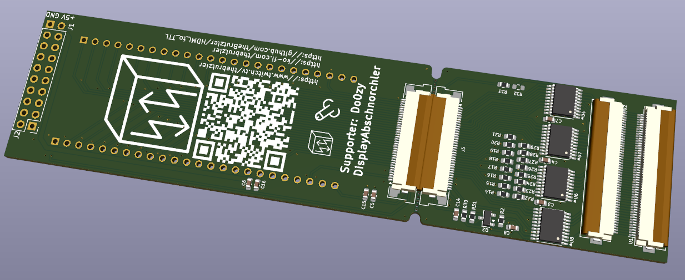

**Unterseite** – hier ist die Umrisslinie des Tang Nano 9K inklusive Lage der HDMI-Buchse aufgedruckt:

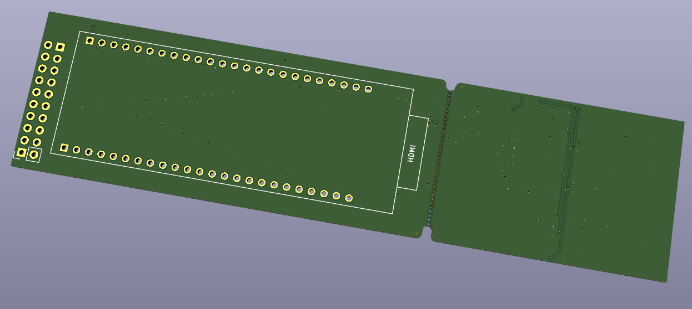

---

## 3. Platine trennen

Die beiden Teile an der Sollbruchstelle vorsichtig auseinanderbrechen und die Bruchkante bei Bedarf leicht entgraten.

**Display-Teil** – kommt ins Oszilloskop zwischen Mainboard und Display. U1/U2 sind die 50-poligen Display-Stecker, J5 ist der 35-polige Anschluss zum FPGA-Teil:

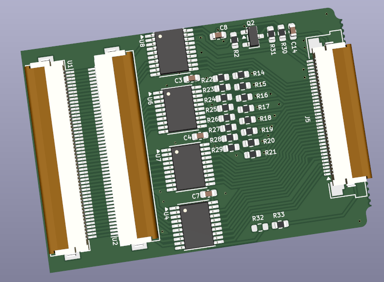

**FPGA-Teil** – Oberseite mit J3 (35-polig, zum Display-Teil) und J1 (+5 V / GND):

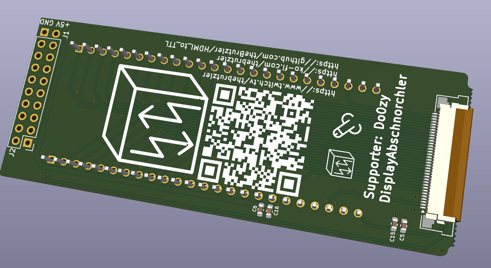

---

## 4. Tang Nano 9K bestücken

Der Tang Nano 9K wird auf der **Unterseite** des FPGA-Teils montiert, also auf der Seite mit der aufgedruckten Umrisslinie (nicht auf der QR-Code-Seite).

1. Die beiden Stiftleisten (1 × 24) in den Tang Nano 9K stecken.
2. Den Tang Nano 9K so auf die Unterseite der Platine setzen, dass er **in der Umrisslinie** liegt:
   - die **HDMI-Buchse** zeigt zur Bruchkante (Aufdruck „HDMI“),
   - die **USB-C-Buchse** zeigt zur Seite mit J1 / J2.
3. Die Stifte stehen dann auf der Oberseite (QR-Code-Seite) durch und werden dort verlötet.
4. Zuerst nur je einen Pin an beiden Enden löten, Lage prüfen (Board liegt plan und gerade in der Umrisslinie), dann die restlichen Pins löten.
5. Überstehende Stifte auf der Oberseite kürzen, damit sie später nichts berühren.

So sieht das bestückte FPGA-Teil aus (Unterseite, noch vor dem Trennen):

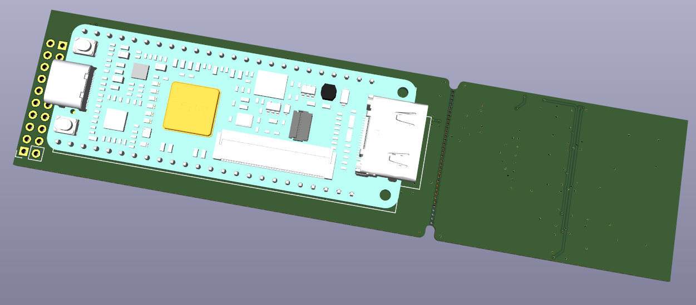

Und nach dem Trennen:

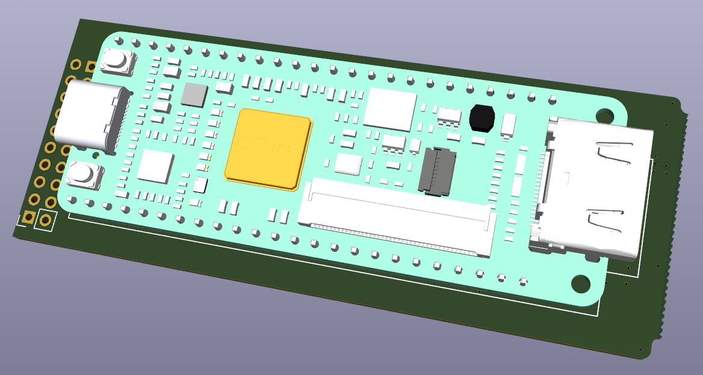

6. Die Buchsenleiste **J1** (1 × 2, +5 V / GND) auf derselben Seite wie den Tang Nano 9K einlöten, also auf der Unterseite. Sie wird beim Einbau auf die Stiftleiste des Mainboards gesteckt (siehe [Abschnitt 6.2](#62-fpga-teil-auf-dem-mainboard-befestigen)).

> **Hinweis:** J2 („ONLY DUMMY“, 2 × 9) wird **nicht** bestückt. Die Löcher dienen nur als Freiraum für die übrigen Pins der Mainboard-Stiftleiste.

Belegung von J1 (auch auf dem Bestückungsdruck markiert):

| J1 Pin | Signal |
|---|---|
| 1 (eckiges Pad) | GND |
| 2 | +5 V |

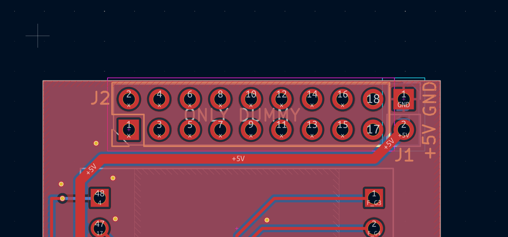

---

## 5. FPGA programmieren

> ⚠️ **Wichtig:** Der Tang Nano 9K muss **vor dem Einbau** ins Oszilloskop fertig programmiert werden. Programmiert wird ausschließlich außerhalb des Geräts – das FPGA-Teil darf dabei **nicht** mit dem Oszilloskop verbunden sein.

Die fertige Konfigurationsdatei liegt im Repository unter:

```
Software/hdmi_letzter_Ki_Stand/impl/pnr/hdmi.fs
```

Wer das Projekt selbst neu bauen will, öffnet `Software/hdmi_letzter_Ki_Stand/hdmi.gprj` in der Gowin EDA und führt *Synthesize* und *Place & Route* aus – danach liegt die `hdmi.fs` an derselben Stelle.

### 5.1 Programmer starten und Board erkennen

1. Tang Nano 9K per USB-C mit dem PC verbinden.
2. **Gowin Programmer** starten (entweder einzeln oder in der Gowin EDA über *Tools → Programmer*).
3. Mit dem Lupen-Symbol (**Scan Device**) nach dem Board suchen. Es sollte ein Eintrag mit
   - Series: `GW1NR`
   - Device: `GW1NR-9C`

   erscheinen. Standardmäßig steht als Operation `SRAM Program` drin.

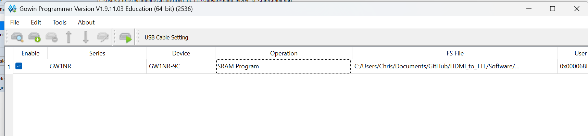

> `SRAM Program` lädt die Konfiguration nur in den flüchtigen Speicher – nach dem Ausschalten ist sie wieder weg. Damit der FPGA die Konfiguration dauerhaft behält, muss in den internen Flash geschrieben werden (nächster Schritt).

### 5.2 Flash-Programmierung einstellen

1. Doppelklick auf die Zeile (Spalte **Operation**) – das Fenster **Device configuration** öffnet sich.
2. Einstellen:
   - **Access Mode:** `Embedded Flash Mode`
   - **Operation:** `embFlash Erase,Program`
3. Unter **File name** die Datei `hdmi.fs` auswählen (Pfad siehe oben).
4. Mit **Save** bestätigen.

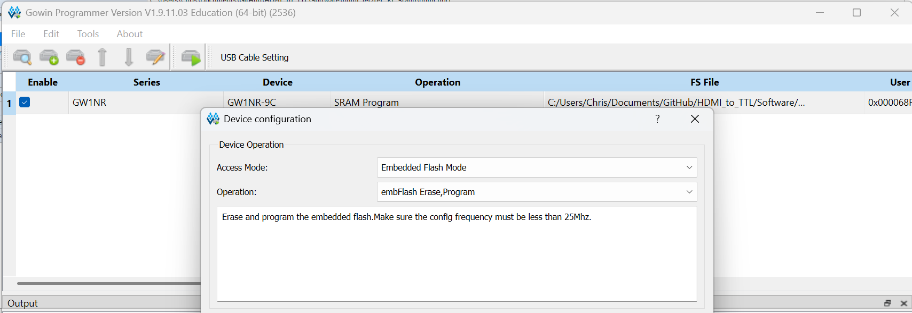

### 5.3 Programmieren

In der Liste steht jetzt als Operation `embFlash Erase,Program` und als FS File der Pfad zur `hdmi.fs`:

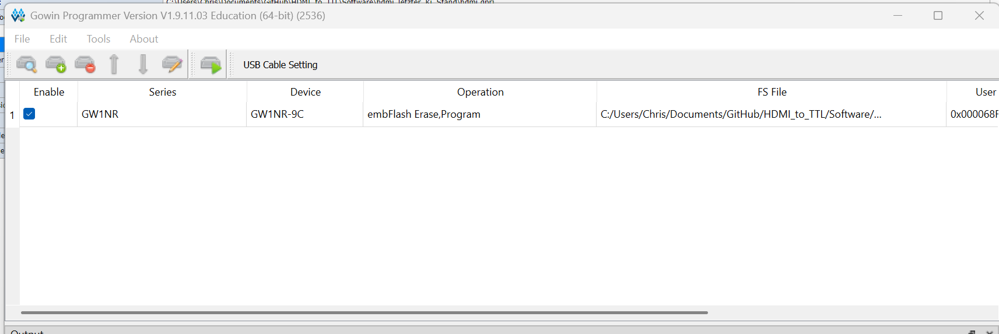

1. Auf das Symbol mit dem grünen Pfeil (**Program/Configure**) klicken.
2. Warten, bis im Output-Fenster unten die erfolgreiche Programmierung gemeldet wird.
3. Fertig – der FPGA startet ab jetzt bei jedem Einschalten mit der HDMI-Konfiguration.
4. USB-C-Kabel wieder abziehen. Erst jetzt darf das Board eingebaut werden.

> **Board wird nicht gefunden?** Unter **USB Cable Setting** prüfen, ob das Kabel erkannt wird, und ggf. *Query/Detect Cable* ausführen. Unter Windows wird ein passender USB-Treiber benötigt (wird mit der Gowin-Software installiert).

---

## 6. Einbau ins Oszilloskop

> ⚠️ Der Einbau erfolgt **auf eigene Gefahr**, es wird **keine Haftung** übernommen. Vor dem Öffnen das Oszilloskop ausschalten und vom Netz trennen.

Voraussetzung: Der Tang Nano 9K ist fertig programmiert (siehe [Abschnitt 5](#5-fpga-programmieren)) und das USB-C-Kabel ist abgezogen.

### 6.1 Display-Teil einsetzen

Das Display-Teil wird zwischen Display und Gehäuse gelegt und in das vorhandene Display-Flachbandkabel eingeschleift:

1. Das originale Display-Flachbandkabel vom Display abziehen.
2. Das neue **50-polige FFC-Kabel** (Raster 0,5 mm) in den Display-Stecker des **Mainboards** und in den oberen 50-poligen Stecker des Display-Teils („To Mainboard“) stecken.
3. Das Kabel des Displays in den mittleren 50-poligen Stecker („To Display“) stecken.
4. Das 35-polige FFC-Kabel in den unteren Stecker J5 („To FPGA“) stecken und zum FPGA-Teil führen.

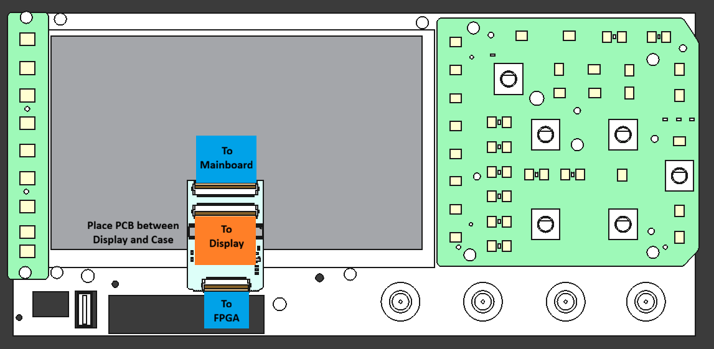

### 6.2 FPGA-Teil auf dem Mainboard befestigen

Das FPGA-Teil liegt auf dem Mainboard, mit der QR-Code-Seite nach oben (der Tang Nano 9K zeigt also zum Mainboard), und wird mit Isolierband fixiert.

1. Das andere Ende des 35-poligen FFC-Kabels in J3 des FPGA-Teils stecken.
2. Das FPGA-Teil an der gezeigten Stelle auf das Mainboard legen und dabei auf die Stiftleiste des Mainboards neben dem Summer stecken (roter Kreis im Bild unten). Die Stiftleiste liegt dann unter J2 und J1 zusammen: Die Löcher von J2 nehmen die übrigen Pins auf, die Buchsenleiste **J1** greift die beiden Pins für **GND** (J1 Pin 1) und **+5 V** (J1 Pin 2) ab. Darüber wird das FPGA-Teil mit 5 V aus dem Oszilloskop versorgt.

   > Vor dem ersten Einschalten mit einem Multimeter prüfen, ob die Platine richtig und nicht versetzt aufgesteckt ist und an J1 tatsächlich +5 V gegen GND anliegen.
3. Darauf achten, dass die gekürzten Pins und die Bauteile des Tang Nano 9K keinen Kontakt zu Bauteilen oder Leiterbahnen des Mainboards haben.
4. Das FPGA-Teil mit Isolierband auf dem Mainboard fixieren.

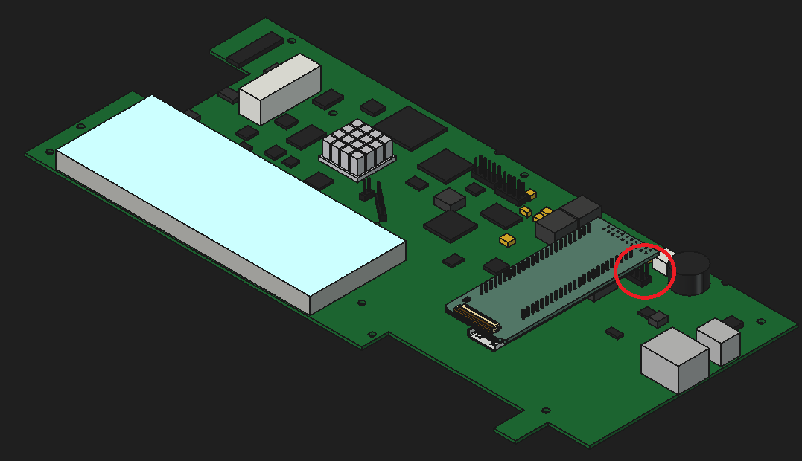

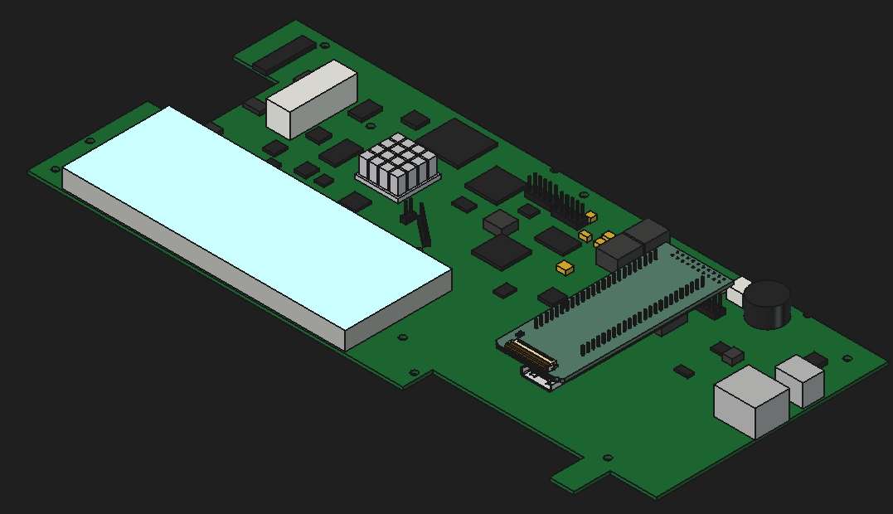

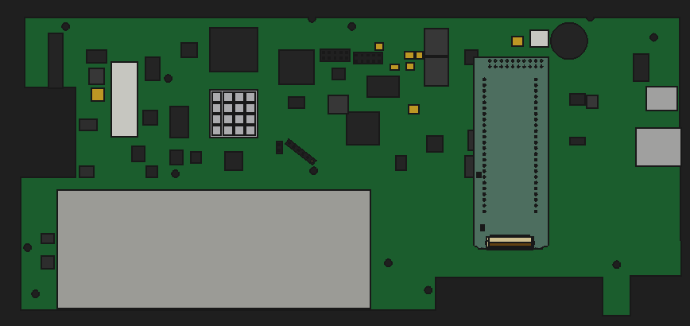

So sieht es eingebaut aus. Links und rechts hält Isolierband die Platine, unten kommt das FFC-Kabel vom Display-Teil, rechts geht das HDMI-Kabel ab:

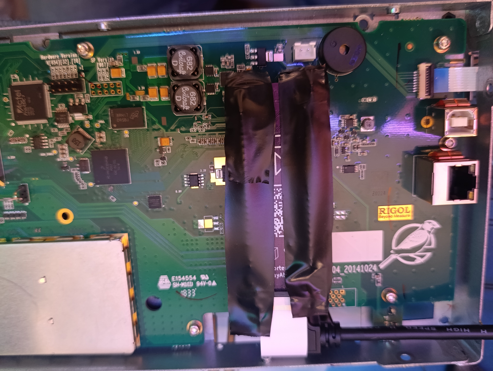

### 6.3 HDMI-Buchse im Gehäuse

Damit das HDMI-Signal nach außen kommt, wird eine kurze HDMI-Einbau-Verlängerung verwendet: Auf der einen Seite ist ein 90°-Winkelstecker, auf der anderen eine Buchse mit zwei Schraublaschen.

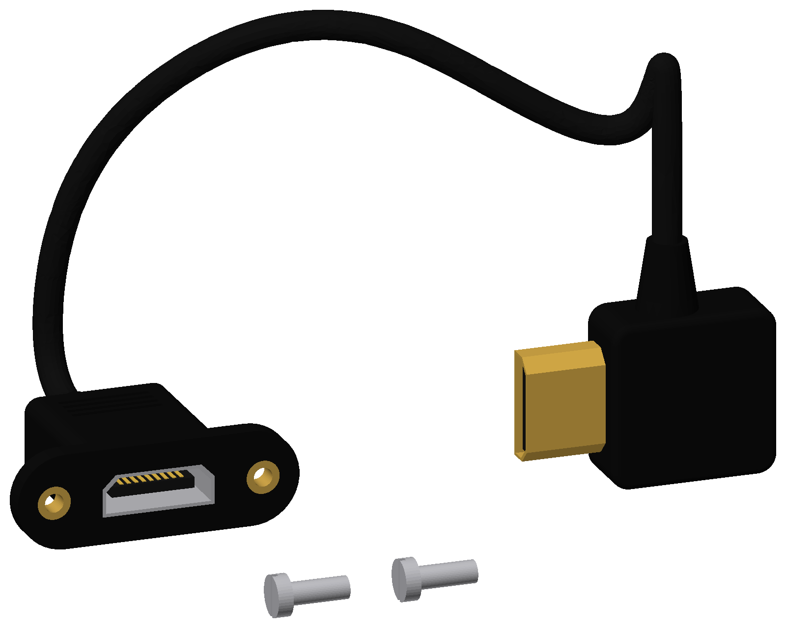

1. Den Winkelstecker in die HDMI-Buchse des Tang Nano 9K stecken.
2. Die Position der Buchse in der Gehäuserückwand anzeichnen (oberhalb von USB-B und LAN), Ausschnitt und zwei Bohrungen für die Schrauben anfertigen.
3. Die Buchse von innen einsetzen und festschrauben.
4. Gehäuse wieder schließen.

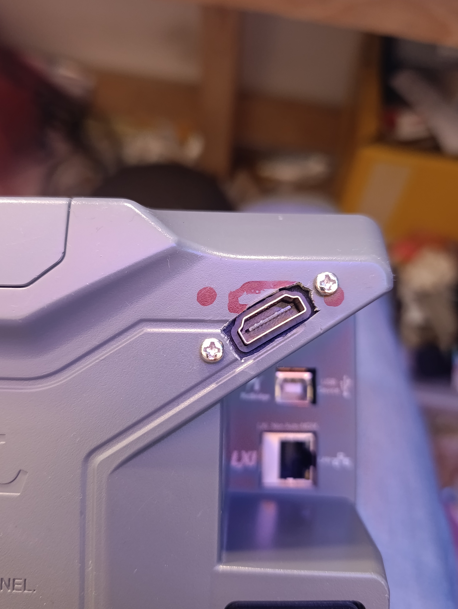

### 6.4 Inbetriebnahme

1. Monitor an die neue HDMI-Buchse anschließen.
2. Oszilloskop einschalten – das Bild erscheint parallel auf dem internen Display und auf dem Monitor.

> ⚠️ **Keine Versorgung über USB-C!** Im eingebauten Zustand darf am Tang Nano 9K **kein USB-C-Kabel** angeschlossen werden. Die 5 V kommen ausschließlich aus dem Oszilloskop über J1. Ein zusätzlich angeschlossenes USB-Kabel würde zwei 5-V-Quellen gegeneinander schalten und kann Oszilloskop, Tang Nano 9K oder den PC beschädigen.

Der FPGA erzeugt den HDMI-Takt selbst aus dem 27-MHz-Oszillator des Tang Nano 9K (Ausgabe 1579 × 525 bei 36 MHz Pixeltakt). Das Eingangsbild wird zwischengepuffert, die Bildrate des Oszilloskops bleibt erhalten.

---

## 7. Fehlersuche (LEDs und UART)

### LEDs auf dem Tang Nano 9K

| LED | leuchtet, wenn … |
|---|---|
| 0 | Eingangspuffer (74HC245) freigegeben |
| 1 | Pixeltakt (PCLK) vom Oszilloskop vorhanden |
| 2 | PLL eingerastet |
| 3 | HSYNC vorhanden |
| 4 | Bilder (DE) werden empfangen |
| 5 | Testbild-Modus aktiv |

### UART-Konsole

Über den USB-Anschluss des Tang Nano 9K steht eine serielle Konsole zur Verfügung (**115200 Baud, 8N1**). Sie gibt jede Sekunde eine Statuszeile mit den gemessenen Eingangssignalen aus.

> ⚠️ Die Konsole nur **außerhalb des Oszilloskops** nutzen (Board nur über USB versorgt, nicht mit dem Oszilloskop verbunden) – siehe Warnung in [Abschnitt 6](#6-einbau-ins-oszilloskop).

| Befehl | Funktion |
|---|---|
| `t` | Testbild ein/aus (gleiches HDMI-Timing wie im Normalbetrieb) |
| `?` | Hilfe |

Mit dem Testbild lässt sich vor dem Einbau prüfen, ob die HDMI-Ausgabe funktioniert: Board per USB anschließen, Monitor an HDMI, in der Konsole `t` senden.

---

## Links

- GitHub: https://github.com/theBrutzler/HDMI_to_TTL
- Twitch: https://www.twitch.tv/thebrutzler
- Ko-fi: https://ko-fi.com/thebrutzler
